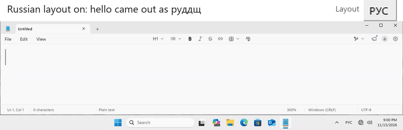
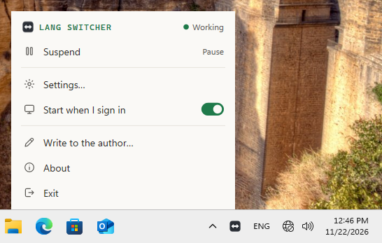
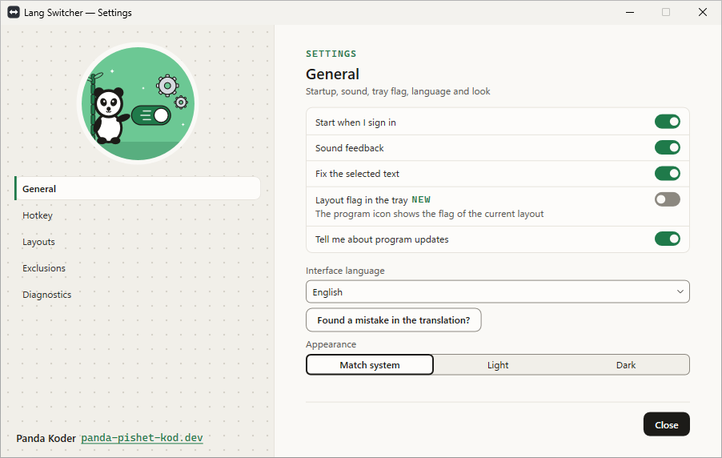

# Lang Switcher



**Lang Switcher fixes text typed in the wrong keyboard layout.** You meant to type `hello`, but the
Russian layout was on, so the screen shows `руддщ`. Press `Pause/Break`: the word becomes `hello`,
and the window switches to the English layout. Press it again and you get the original back,
exactly as you typed it. One key, no setup, nothing to learn.

[По-русски](README.ru.md) — переключатель раскладки клавиатуры, который исправляет слово, набранное не в той раскладке.

**Download:** [Releases](https://github.com/panda-pishet-kod/lang-switcher/releases/latest) of this repository · [the download page](https://panda-pishet-kod.dev/en/langswitcher/download/) of the site. Windows 10 and 11.

**How it differs from auto-switchers.**

- **It fixes, it does not guess.** The program does not decide for you which word is wrong and
  changes nothing on its own: a word is converted only when you press the key, so a word that was
  right is never "corrected".
- **One key.** `Pause/Break` by default; another key, a combination or a double tap of `Shift` if
  you prefer.
- **The original comes back byte for byte.** A second press restores exactly what you typed: the
  program keeps the keys you pressed, not the converted text.

A small tray program, free and open source under `MIT OR Apache-2.0`, with the interface in 66
languages.

<table>
  <tr>
    <td align="center" valign="top"><br>The tray menu</td>
    <td align="center" valign="top"><br>Settings</td>
  </tr>
</table>

[Program page](https://panda-pishet-kod.dev/en/langswitcher/) · [Keyboard layout converter](https://panda-pishet-kod.dev/en/keyboard-layout-converter/) · [Questions and answers](https://panda-pishet-kod.dev/en/langswitcher/docs/) · [No Pause/Break key on your laptop?](https://panda-pishet-kod.dev/en/langswitcher/docs/hotkey/)

**Status:** version **1.6.0**; the interface speaks **66 languages** (see [Languages](#interface-languages-and-keyboard-layouts)).
What changed in each version is in [CHANGELOG.md](CHANGELOG.md) and on the [Releases](https://github.com/panda-pishet-kod/lang-switcher/releases) page.

## How it works

- **The word you just typed.** Lang Switcher remembers the keys you pressed — the keys, not the
  text — and on `Pause/Break` retypes them in the other layout, erasing the wrong word first. A
  second press goes back, character for character, because the program keeps the keys themselves
  and never overwrites them with the result.
- **Selected text.** Select any text, press `Pause/Break`, and the selection is converted. The
  clipboard is put back exactly as it was afterwards, every format of it.
- **Nothing typed, nothing selected.** Press `Pause/Break` and the layout switches to the next one
  of the program's cycle; press again to go on, or back with two layouts. In a password field the
  key only switches the layout and never converts what was typed.
- **Which layouts.** By default, the two layouts you use most; you can name a pair or a cycle of
  several in the settings window.
- **Where.** Notepad, Word, browsers, messengers, Windows Terminal and the classic console. It also
  works in programs run as administrator. In password fields the program keeps no record of your
  keys at all.

## Download and install

Releases are on the [Releases](../../releases) page of this repository and on the
[download page](https://panda-pishet-kod.dev/en/langswitcher/download/) of the site. The installer
speaks the language of your Windows.

**If the browser or Windows warns you.** The program is signed with the author's own certificate,
not one from a certification authority, and a new release is still downloaded rarely, so you will
see warnings — this is expected:

- **Edge:** in Downloads, "…" → "Keep", then in the dialog "Delete ▾" → "Keep anyway".
- **Chrome:** "Download suspicious file".
- **Windows** may show "Windows protected your PC" — "More info" → "Run anyway". Then the yellow UAC
  prompt — "Yes".

Every window, step by step: [Edge](https://panda-pishet-kod.dev/en/langswitcher/download/edge/) · [Chrome](https://panda-pishet-kod.dev/en/langswitcher/download/chrome/) · [Opera](https://panda-pishet-kod.dev/en/langswitcher/download/opera/) · [Yandex Browser](https://panda-pishet-kod.dev/en/langswitcher/download/yandex/) · [Firefox](https://panda-pishet-kod.dev/en/langswitcher/download/firefox/).
You can check the file against the SHA-256 on its release page.

**What the installer does with a certificate.** Your Windows does not trust the author's
certificate, so the installer creates one of its own on your computer, "Lang Switcher (local)": good
**for code signing only**, not a certification authority, for 30 years. It signs the program with it,
**destroys the private key at once**, and puts the public part into the computer's Trusted Root
Certification Authorities. Uninstalling the program removes that certificate. If you would rather
not have it, run `LangSwitcher-setup.exe /NOLOCALCERT`: you get a copy of the program without the
certificate, which works everywhere except in programs run as administrator.

## Requirements

Windows 10 or Windows 11, 64-bit. No runtime to install, no account, no internet needed to work.

## Interface languages and keyboard layouts

**The interface** speaks 66 languages — 64 languages, Serbian and Uzbek in both of their scripts;
Hebrew, Arabic, Urdu, Persian and Uyghur read right to left. The language list of the settings puts
the language of Windows, English, the languages of your keyboard layouts and Russian on top, and the
rest by name.

<details>
<summary>All 66 interface languages</summary>

English, Russian, Ukrainian, German, French, Spanish, Portuguese, Italian, Polish, Czech, Turkish,
Greek, Hebrew, Arabic, Hindi, Bengali, Urdu, Punjabi, Marathi, Telugu, Tamil, Persian, Gujarati,
Thai, Kannada, Odia, Malayalam, Uzbek (Latin and Cyrillic), Nepali, Assamese, Azerbaijani, Khmer,
Kazakh, Serbian (Cyrillic and Latin), Uyghur, Bulgarian, Armenian, Lao, Belarusian, Tatar, Georgian,
Macedonian, Vietnamese, Dutch, Romanian, Hungarian, Swedish, Albanian, Danish, Finnish, Croatian,
Slovak, Norwegian Bokmål, Lithuanian, Slovenian, Bosnian, Latvian, Estonian, Welsh, Maltese,
Icelandic, Luxembourgish, Māori and Norwegian Nynorsk.

</details>

**Typing.** The program converts between any two Windows keyboard layouts installed on your
computer, except layouts with an IME (Chinese, Japanese, Korean), where a character is built from
several keys in a candidate window. It was **measured** on the layouts of Windows 11 for **102
languages — 107 combinations of a language and a script** (96, plus 11 smaller scripts): 16
Cyrillic, 45 Latin with letters of their own, 34 with a script of their own (Arabic, Hebrew, Greek,
Armenian, Georgian, Thai, the Indian scripts and more) and Fula in ADLaM; then 11 smaller scripts
(Cherokee, Javanese, Inuktitut in syllabics and in Latin letters, and others). Azerbaijani, Serbian,
Mongolian, Central Atlas Tamazight and Inuktitut are each counted with two scripts.

<details>
<summary>The finer points</summary>

- Letters a layout gives only with `AltGr`, dead keys (two in a row as well: BÉPO `´`, `´`, `o` is
  `ő`) and keys that print several characters at once (Arabic `لا`, Indian conjuncts) are
  converted the way Windows itself types them.
- Text in scripts with signs above and below the letters is erased and selected exactly: the
  program counts letters the way Windows does (Thai `สวัสดี` is 4 letters and 6 code points).
  In Notepad of Windows 11 the `backspace` method goes by the selection, like `auto`: that field
  loses or repeats characters of an insertion after `Backspace`, and it takes a typed Tamil
  consonant with its pulli (`க்`) off sometimes with one press, sometimes with two. The first press
  over a typed word selects it there by its position in the text, not by caret stops: one stop or
  three on the Tamil conjunct `க்ஷ`, and no count is right for both.
- When a key of the layout is ambiguous (Arabic 101: `لا` is one key, `B`, and also two, `G` and
  `H`) and the word was not typed just now, the program picks the reading that is more probable in
  the target language. It has letter statistics for English, French, Spanish and Russian, and since
  1.2.0 for Arabic, Persian, Indonesian, Hindi, Tamil and Sinhala.
- The level of the right `Ctrl` of Canadian Multilingual Standard (the only layout of Windows with
  such a level, Japanese aside) converts into the same level of a layout that has it; a target
  layout without it does not take such a word, and the program sounds a refusal instead.
- In selected text the program cannot see `CapsLock`, and a character the target layout does not
  have is carried over as it is.

</details>

**Where the letter statistics come from:** public-domain books of Project Gutenberg (English,
French, Spanish, Russian) and the Leipzig Corpora Collection, Universität Leipzig, licensed CC BY
(the six languages of 1.2.0; the Sinhala corpus is drawn from Wikipedia, CC BY-SA). Only tables of
letter frequencies are in the program, not the texts.

## The hotkey

`Pause/Break` by default. In the settings window you can set another key, alone or with `Ctrl`,
`Alt` and `Shift` (`Ctrl+F12`, `Alt+Shift+K`), or a **double tap of `Shift`** — two short taps in a
row. No `Pause` key? Try `Fn+Pause`, a combination such as `Ctrl+F12`, `CapsLock` or the double
`Shift`.

In the settings file `%APPDATA%\Lang_Switcher\config.toml`:

```toml
[hotkey]
key       = "F12"
modifiers = ["Ctrl"]    # any of "Ctrl", "Alt", "Shift"; [] for the key alone
trigger   = "press"     # press, or double_tap (with key = "Shift" only)
```

## Privacy

Your keystrokes are **never** written to disk — not to the log, not to the settings, not to
temporary files.

Once a day Lang Switcher reads a short news file from the author's site; it sends nothing about your
computer. When a new version comes out, the program downloads it from the same site by itself,
checks the author's signature and installs it while the computer is idle. A short notice by the tray
icon tells you when it has been updated.

A message to the author from the wizard goes to the site only when you press **Send** yourself —
exactly the text you saw before sending; a way to contact you is optional.

How it works, in detail:

- **The news file** is `https://panda-pishet-kod.dev/langswitcher/news.toml` — one `GET` request
  with no parameters — but once: the first read after an installation (when the program creates its
  settings file itself) adds `?first=1` to the address, with no number and nothing about the
  computer, and stops after the site's first answer; an update sends no such mark. The header
  carries only the name and the version number of the program, for example `LangSwitcher/1.6.0`.
  If it does not come, the next try is not before tomorrow. Letters and news
  from it can be turned off in the settings file (`[letters] feed = false`), and, after the first
  letter of the feed but not earlier than 90 days after the first start, in the "From the author"
  window as well.
- **Updates** are installed not by the program itself but by a separate file without a window,
  `LangSwitcherUpdate.exe`, a scheduled task "Lang Switcher Update" running as the system. It takes
  the installer only from the `/langswitcher/files/` folder of the same site; its size and SHA-256
  must match the ones signed in the news file, and its version must be newer than yours. If the new
  version does not start, the previous one comes back.
- **A message from the wizard** is one `POST` request to
  `https://panda-pishet-kod.dev/langswitcher/feedback`, sent only when you press **Send** or
  **Retry**. It carries the text of the message as it stands in the window, the language of the
  interface, the kind of message (a problem or a suggestion), the version of the program, your
  contact if you typed one, and a random number of the request so that the site does not file a
  repeat twice. The program waits for the answer no longer than 15 seconds. If the site does not
  answer, the wizard offers to send the same text by email to `lang.switcher@panda-pishet-kod.dev`
  or to save it to a file.

There is no other network activity. The details are in section 9 of the specification (in Russian).

## Reporting a problem or an idea

The tray menu → "Write to the author…" opens a short wizard: it collects what is useful (only what
you leave ticked), shows you the whole text, and sends it with **Send**. Or open an issue in
[Issues](../../issues) — in English or Russian.

## Building from source

```bash
cargo build --release
```

Before a release build:

```bash
cargo clippy -- -D warnings
```

```bash
cargo test
```

The tests are tied to the developer's machine (exactly two layouts, Russian and US) and are not
expected to pass unchanged elsewhere; this is a decision of the project, not a defect. The release
scripts, the installer and the signing are described in [README.ru.md](README.ru.md) and in the
specification `SPEC.md`; like the other documents of the project, they are in Russian.

## License and authorship

Copyright © 2026 Panda Koder

The source code is available under either of **MIT or Apache-2.0**, at your option:
[`LICENSE-MIT`](LICENSE-MIT), [`LICENSE-APACHE`](LICENSE-APACHE). Contributions are accepted under
[`CLA.md`](CLA.md); see [`CONTRIBUTING.md`](CONTRIBUTING.md).
